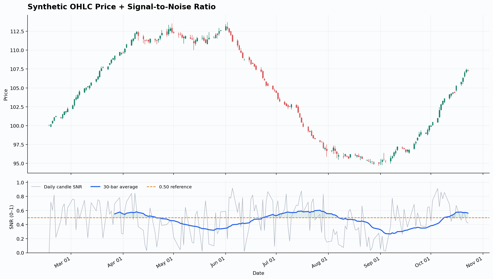

# Signal-to-Noise Ratio Indicator
**CODE__PEARL**



A lightweight Python indicator that measures how much of each OHLC candle is **signal** (body) versus **noise** (wick). Inspired by Ken Long's signal-to-noise framing for market regimes.

The idea: in a clean, directional market, candles close near their extremes — big bodies, small wicks. In choppy, mean-reverting conditions, price gets rejected — small bodies, long wicks. The SNR indicator turns that observation into a single number you can plot and monitor.

## How It Works

**Per-candle SNR**

```text
candle_snr = |Close − Open| / (High − Low)
```

The value is bounded between 0 and 1:

| Value | Meaning |
| --- | --- |
| **0.0** | Open and close are identical — the bar is almost entirely wick (pure noise) |
| **1.0** | The body spans the entire high-low range — virtually no wick (pure signal) |

**Rolling SNR**

The indicator line is the simple average of `candle_snr` over the last *N* bars (default: 30). A rolling average above ~0.50 suggests conditions are relatively directional; below ~0.50 suggests chop.

Zero-range candles (High == Low) are treated as undefined rather than counted as 0.

## Example Output

Running the script with default settings produces a two-panel chart:

- **Top panel** — candlestick chart of the price data
- **Bottom panel** — per-bar SNR (grey), the rolling *N*-bar average (blue), and a dashed 0.50 reference line

By default the script generates synthetic data that cycles through trending and choppy regimes, so you can see the indicator respond to regime changes immediately.

## Installation

Requires Python 3.9+ with pandas, numpy, and matplotlib:

```bash
pip install pandas numpy matplotlib
```

## Usage

**Run with synthetic data (default):**

```bash
python signal_to_noise_indicator.py
```

**Use your own data:**

```bash
python signal_to_noise_indicator.py --csv prices.csv --window 30
```

The CSV needs these columns (case-insensitive; a `DateTime` or `Timestamp` column also works for dates):

```text
Date, Open, High, Low, Close
```

### CLI Options

| Flag | Default | Description |
| --- | --- | --- |
| `--csv` | *(none)* | CSV with Date, Open, High, Low, Close columns; omit to use synthetic data |
| `--window` | `30` | Rolling average window in bars |
| `--bars` | `180` | Number of synthetic bars when `--csv` is not supplied |
| `--output` | `signal_to_noise_demo.png` | Output chart PNG path |
| `--data-output` | `signal_to_noise_values.csv` | Output CSV including the computed SNR columns |

### What You Get

- `signal_to_noise_demo.png` — price + SNR chart
- `signal_to_noise_values.csv` — the full dataset with added columns:
  - `SNR` — per-candle signal-to-noise ratio
  - `SNR_30bar` — rolling *N*-bar average (named after your window)
  - `BodyDirection` — +1 (up candle), −1 (down candle), 0 (doji)

The console also prints the latest rolling SNR value, e.g.:

```text
Bars: 180
Latest 30-bar SNR: 0.612 (61.2%) on 2026-10-23
```

## Interpreting the Values

- **SNR climbing above 0.5** — bodies are dominating wicks; price is moving with conviction.
- **SNR falling below 0.5** — wicks are dominating bodies; price is being rejected at extremes.
- **No default magic number** — the 0.50 line is a reference, not a hard signal threshold. Evaluate the indicator per market and timeframe; some instruments rarely exceed 0.5 even in strong trends.

As with any indicator, this is descriptive, not predictive — it characterizes the *current* regime rather than forecasting the next one.

## Notes & Limitations

- SNR is scale-free (a ratio), so it's comparable across instruments and timeframes.
- The rolling average needs a full window before producing values (`min_periods=window`).
- No trend/drift direction is implied — SNR only measures body-vs-wick quality, not direction. Use `BodyDirection` alongside it if direction matters.
- Not financial advice.

## License

MIT
